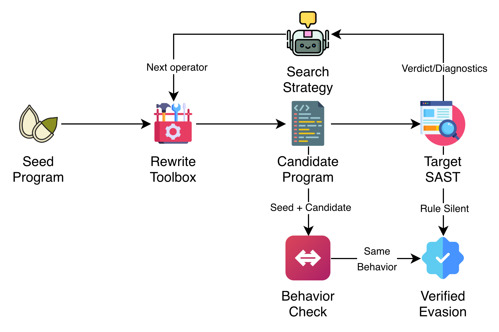

# SASTLab

SASTLab evaluates whether Python static application security testing (SAST) scanners retain detections under semantics-preserving AST transformations. Given a seed program that a scanner flags and a runtime oracle confirms exploitable, SASTLab applies deterministic rewrite operators, verifies identical output on nominal and exploit inputs, and records any transformation after which the target rule stops firing.

- **4 scanners:** Semgrep (`1.178.0`), CodeQL (`2.27.1`), Pysa (`pyre-check` `0.10.0`), and Bandit (`1.9.4`).
- **3 vulnerability classes:** SQL injection (CWE-89), command injection (CWE-78), and path traversal (CWE-22).
- **18 deterministic AST operators:** Bitmask-encoded transformations applied from the original seed (no LLM writes code).
- **7 search strategies:** Random, heuristic, three LLM-guided agents (`llama3.1:8b`, `qwen3-coder-next`, `qwen3.6:35b`), and two Metropolis walks.



A **verified evasion** requires all three conditions: (1) clean scanner execution (`scan.status == "ok"`), (2) identical oracle outputs on tested nominal and exploit inputs (`equivalent == true`), and (3) silence on the qualifying rule(s). Scanner crashes or timeouts fail closed and never count as evasions.

## Contents

- [Documentation Map](#documentation-map)
- [Key Findings at a Glance](#key-findings-at-a-glance)
- [Reproducibility Tracks](#reproducibility-tracks)
- [Architecture and Codebase Map](#architecture-and-codebase-map)
- [CLI and Configuration Reference](#cli-and-configuration-reference)
- [Operators, Strategies, Scanners, and Artifacts](#operators-strategies-scanners-and-artifacts)
- [Environment and Scope Limits](#environment-and-scope-limits)

---

## Documentation Map

| Document | Purpose |
| --- | --- |
| [README.md](README.md) | Setup, reproducibility tracks, CLI usage, configuration schema, and module layout |
| [docs/methodology.md](docs/methodology.md) | Complete technical specification for re-implementation (oracle, AST transforms, scanner adapters, search, wire protocol, report cards) |
| [docs/prompts.md](docs/prompts.md) | Verbatim LLM system prompts, observation JSON schemas, and per-config `prompt_extra` variants |
| [docs/validation.md](docs/validation.md) | Upstream suite validation, 187 automated tests, behavior-equivalence checks, determinism, and integrity audits |
| [result.md](result.md) | Full empirical findings across campaigns, corpora, analyzers, mechanisms, and agent evaluations |
| [results/INDEX.md](results/INDEX.md) | Catalog of all 115 saved run folders in `results/` |
| [THIRD_PARTY.md](THIRD_PARTY.md) | Provenance and licenses for third-party rules, models, and adapted benchmark seeds |

---

## Key Findings at a Glance

An evasion demonstrates a rule false negative under this harness (not exploit delivery rate). Full tables and bootstrap intervals are in [result.md](result.md).

| Analyzer & SQL Rule | Rewrites That Silence It |
| --- | --- |
| Semgrep `formatted-sql-query` (pattern) | Structural/sink rewrites moving the query or call (`extract_1`, `extract_2`, `branch_split`, `dict_dispatch`, `dynamic_sink`); `literal_slice` works alone on `%`/`.format()` or paired with `format_swap` on f-strings. |
| CodeQL `py/sql-injection` (data-flow) | Any of the 9 flow-changing rewrites (`dynamic_sink`, `char_launder`, `deep_nest`, `db_roundtrip`, `simplequeue_roundtrip`, `pickle_roundtrip`, `partial_sink`, `methodcaller_sink`, `unbound_sink`). Control rewrites alone never evade. |
| Pysa rules `5005` + `5051` | Single round-trip (`db_roundtrip` or `simplequeue_roundtrip`), or a sink-resolution rewrite paired with `literal_slice` (each eliminates one rule). |
| Bandit `B608` | `literal_slice`, or `format_swap` on `+` concatenation. |

For command injection (CWE-78) and path traversal (CWE-22), rules match sinks rather than SQL string formatting, so restructuring operators do not evade; sink-resolution operators evade Semgrep and Pysa, while flow-changing operators evade CodeQL. Whether LLM guidance outperforms random search depends on the model, rule type, and whether the prompt states the analyzer rules and fixed operator ordering.

---

## Reproducibility Tracks

> **Archive extraction note:** Unpack release zips with `unzip` to keep executable bits on `run.sh` and `analysis/*.sh`. Python's `python3 -m zipfile -e` strips permissions; restore them with `chmod +x run.sh analysis/*.sh`.

### Track A — Recompute Report Tables & Inspect Results (Offline, ~3 min, Stdlib Only)

Requires only Python 3 (no scanners, Docker, or API key). All analysis scripts read from `results/` and print plain-text tables to stdout without generating `.tex` files:

```sh
# Recompute all 15 offline analysis reports into analysis/out/*.txt
./analysis/run_all.sh

# Or run a single table/RQ script directly to stdout from any directory
python3 analysis/table3.py
python3 analysis/rq5.py

# Inspect an individual search campaign report card (read-only)
python3 -m sastlab report results/semgrep-v6

# Browse all 115 saved run folders
less results/INDEX.md
```

### Track B — Run the Automated Test Suite (~2 min, No API Key)

**Option 1 — Docker (pins Python 3.14, Semgrep, CodeQL, Pysa, Bandit):**

```sh
docker build -t sastlab .
docker run --rm sastlab          # 181 passed, 6 skipped (image omits results/)
```

**Option 2 — Local Linux x86-64 installation (mirrors [Dockerfile](Dockerfile)):**

```sh
python3.14 -m venv .sastlab/.venv       && .sastlab/.venv/bin/pip install -r requirements.lock
python3.14 -m venv .sastlab/pysa-venv   && .sastlab/pysa-venv/bin/pip install -r requirements-pysa.lock
python3.14 -m venv .sastlab/bandit-venv && .sastlab/bandit-venv/bin/pip install -r requirements-bandit.lock

mkdir -p .sastlab/tools && curl -fsSL -o /tmp/codeql.tar.zst \
  https://github.com/github/codeql-action/releases/download/codeql-bundle-v2.27.1/codeql-bundle-python-linux64.tar.zst \
  && zstd -dc /tmp/codeql.tar.zst | tar -x -C .sastlab/tools && rm /tmp/codeql.tar.zst

# Run all 187 tests (182 passed, 5 skipped outside Docker when optional scanner checks skip)
PYTHONDONTWRITEBYTECODE=1 .sastlab/.venv/bin/python -m pytest -q -p no:cacheprovider
```

### Track C — Run Transforms, Exhaustive Scans, and Non-LLM Search (No API Key)

By default, `./run.sh` scopes the process tree to 85% CPU using `systemd-run --user`. On environments without a systemd user session (macOS, containers, headless CI), set `export SASTLAB_CPU_LIMIT=0` first (otherwise `run.sh` exits with code `3`):

```sh
export SASTLAB_CPU_LIMIT=0

# Materialize and oracle-check one candidate (mask 5 = bit 0 rename + bit 2 literal_slice)
./run.sh transform seeds/seed_01.py --mask 5 --output runs/candidate.py

# Run non-LLM search strategies (1=random, 2=heuristic, 6=AST Metropolis, 7=depth Metropolis)
./run.sh run --config configs/smoke.json --output runs/my-smoke --strategies 1 2 6 7 --attempts 3 --trajectories 1 --seed-limit 1

# Run exhaustive single-operator enumeration (writes to runs/, keeping results/ untouched)
./run.sh exhaustive --config configs/semgrep-official.json --output runs/my-first --seed-limit 1 --max-ops 1
```

Write new runs to `runs/` (git-ignored) and pick a fresh `--output` directory per run because `analysis/` aggregates over `results/`.

### Track D — Run LLM-Guided Search (Strategies 3, 4, and 5)

Copy `.env.example` to `.env` and set `SOCLAAS_API_KEY` (or export it in your shell). Requests target NUS SoCLaaS (`https://soclaas-api.comp.nus.edu.sg/v1`) for `llama3.1:8b`, `qwen3-coder-next`, and `qwen3.6:35b`. The API key is sent solely in the `Authorization` header (never redirected or logged in manifests/audit records):

```sh
./run.sh doctor --config configs/semgrep.json   # verify API key, served model, and scanner binaries
./run.sh run --config configs/semgrep.json --output runs/my-semgrep --attempts 3 --trajectories 1 --seed-limit 1
```

### Track E — Reproduce Root-Cause Mechanism Probes & Helper Scripts

```sh
# Re-scan added Pysa/CodeQL models (~15 min; requires scanners installed under .sastlab/)
./analysis/run_mechanism.sh

# Witness-path laundering probe (CodeQL) and rewrite catalog
.sastlab/.venv/bin/python scripts/path_probe.py configs/codeql-diverse.json runs/codeql-path-probe
.sastlab/.venv/bin/python scripts/rewrite_catalog.py configs/codeql.json runs/codeql-rewrite-catalog
```

---

## Architecture and Codebase Map

### Execution Data Flow

```text
Seed + Bitmask ──▶ transforms.py (canonical AST rewrite in bit order 0..17)
                         │
                         ├──▶ oracle.py / oracle_worker.py (isolated subprocess, 2 inputs)
                         └──▶ scanners.py (Semgrep / CodeQL / Pysa / Bandit, fail-closed)
                                    │
                                    ▼
                        search.py (Strategies 1–7) ◀── llm.py (Strategies 3–5 via SoCLaaS)
                                    │
                                    ▼
                 runner.py / exhaustive.py ──▶ results/ or runs/ (JSON/JSONL artifacts)
                                    │
                                    ▼
                       report.py / analysis/*.py (report cards, tables, RQs, equivalence)
```

### Package & Directory Structure

| Path | Role |
| --- | --- |
| [`sastlab/cli.py`](sastlab/cli.py) | CLI entry point (`doctor`, `run`, `exhaustive`, `transform`, `report`) |
| [`sastlab/transforms.py`](sastlab/transforms.py) | Canonical 18-operator bitmask AST compiler, `TAXONOMY`, `OPERATOR_HELP`, sink lists |
| [`sastlab/oracle.py`](sastlab/oracle.py), [`sastlab/oracle_worker.py`](sastlab/oracle_worker.py) | Subprocess runtime oracle (`python -I -B`) with per-call temporary directory cleanup |
| [`sastlab/scanners.py`](sastlab/scanners.py) | Fail-closed scanner subprocess wrappers, SARIF/JSON parsers, `typed_for_pysa`, `routed_for_semgrep` |
| [`sastlab/search.py`](sastlab/search.py) | Strategies 1–7, `d_syntax` AST LCS metric, `d_depth`, Metropolis acceptance, `metropolis_restart` |
| [`sastlab/llm.py`](sastlab/llm.py) | OpenAI-compatible SoCLaaS client, byte-budget observation truncation, HTTP 429 & JSON schema retries |
| [`sastlab/runner.py`](sastlab/runner.py) | Config loader, trajectory checkpoint/resume loop, persistent `scan_cache`, bypass artifact writer |
| [`sastlab/exhaustive.py`](sastlab/exhaustive.py) | Subset enumerator (`evaluations.jsonl`) and exhaustive summary checker |
| [`sastlab/report.py`](sastlab/report.py) | Rule report-card classifier (`weak`, `guidance-sensitive`, `robust`, `exploratory`, `incomplete`, `excluded`) |
| `configs/` | `93` experiment configurations (JSON) |
| `seeds*/`, `corpus_*/` | Seed suites: `seeds/` (15 main SQL), `seeds_diverse/` (12 varied), `seeds_fstring/` (3), `corpus_official/seeds/` (9), `corpus_real/seeds/` (6), `corpus_apps/seeds/` (5), `seeds_cmd/` (8 CWE-78), `seeds_path/` (8 CWE-22), `seeds_pysa_hard/` (3), `seeds_pysa_hard2/` (3), `seeds_rerun_s05/` (1) |
| `rules/`, `third_party/` | Pinned Semgrep YAML rules + `.provenance.json`; unmodified Pysa models (`d5614e0a`) |
| `results/` | `115` saved experiment and validation folders indexed in [results/INDEX.md](results/INDEX.md) |
| [`analysis/`](analysis/run_all.sh) | `setup.py`, `table3.py`–`table6.py`, `rq1.py`–`rq6.py`, `lessons.py`, equivalence & mechanism scripts |
| `scripts/` | Two research probe scripts (`path_probe.py`, `rewrite_catalog.py`) |
| `tests/`, `docs/` | `11` pytest modules (`187` tests); methodology, validation, and prompt specifications |

### Analysis Scripts Summary

| Script(s) | Output |
| --- | --- |
| `common.py`, `candidates.py` | Shared readers, evasion filters, 5,000-resample stream-paired bootstrap (seed `11`), candidate deduplication, AST shape classifier |
| `setup.py` | Table 2 (corpora), budgets, minimal evading sets, CodeQL timings, fallbacks, scan-cache configs, rewrite catalog |
| `table3.py`–`table6.py` | Table 3 (single-rewrite cross-analyzer matrix), Table 4 (4 additional corpora), Table 5 (restricted LLM paired CIs), Table 6 (Pysa prompt search) |
| `rq1.py`–`rq6.py`, `lessons.py` | Detailed breakdowns and claims for RQ1–RQ6 and negative/lesson analyses |
| `extended_equivalence.py`, `cmd_equivalence.py`, `path_equivalence.py` | Multi-input equivalence checks (`20` SQL, `12` command, `14` path inputs) |
| `mechanism_pysa.py`, `mechanism_codeql*.py` | Call-graph, sink-node, depth-sweep, and added-model repairs (RQ5) |

---

## CLI and Configuration Reference

### CLI Commands

| Command | Behavior |
| --- | --- |
| `./run.sh run --config C --output D` | Runs configured search campaign across qualifying seeds. Flags: `--attempts`, `--trajectories`, `--seed-limit`, `--strategies`, `--resume`, `--rerun-errors`, `--scanner-timeout`. |
| `./run.sh exhaustive --config C --output D --seed-limit N` | Scans every non-empty subset without search or LLM (`--operators ...`, `--max-ops K`, `--resume`). |
| `./run.sh transform SEED --mask M [--output F]` | Applies bitmask `M` to `SEED`, runs oracle verification, writes source to `F` (or stdout) and JSON check to stderr. |
| `./run.sh report D [--write]` | Recomputes search summary from `attempts.jsonl` to stdout (`--write` updates `summary.json`). |
| `./run.sh doctor [--config C]` | Verifies SoCLaaS API access/model serving and prints detected paths for all 4 scanners. |

- **Resume & error recovery:** `run --resume` discards incomplete trajectories (`discarded-partial.jsonl`) and restarts them from scratch so walks never splice. If a baseline scan fails, `exhaustive` stops cleanly (resumable via `--resume`), while `run` completes remaining seeds, exits `1`, and repairs missed baselines with `--rerun-errors`.

### Configuration File Schema (`configs/*.json`)

Run `./run.sh` from the repository root: `seeds`, `rules`, `pysa_models`, and `llm.env_file` resolve relative to the config directory, while `scan_cache`, `work_dir`, and `executable` resolve relative to the working directory.

Minimal annotated example (modeled on [configs/smoke.json](configs/smoke.json)):

```json
{
  "engine": "semgrep",
  "seeds": "../seeds",
  "rules": "../rules/demo-sqli.yaml",
  "corpus_kind": "synthetic",
  "attempts": 30,
  "trajectories": 5,
  "base_seed": 6223,
  "strategies": [1, 2, 3, 4, 5, 6, 7],
  "cache": true,
  "llm": {
    "provider": "soclaas",
    "model": "llama3.1:8b",
    "env_file": "../.env",
    "temperature": 0.2,
    "max_prompt_tokens": 2500
  }
}
```

| Key | Description |
| --- | --- |
| `engine` | `semgrep`, `codeql`, `pysa`, or `bandit` |
| `seeds`, `seed_limit` | Path to seed directory and optional seed cap |
| `rules` / `query` / `target_rules` | Local rule YAML (Semgrep), `@`-version-pinned CodeQL query pack, and counted rule IDs |
| `attempts`, `trajectories`, `base_seed`, `strategies` | Budget per trajectory, trajectory count (`trajectory_seed = base_seed + k`), strategies `1..7` |
| `operators`, `order` | Optional operator pool subset; `increasing` (default) or `any` order |
| `evasion` | `any` (default: 1 qualifying rule silenced) or `all` (all qualifying rules silenced, e.g. Pysa) |
| `metropolis_restart` | `true` (default: Strategies 6–7 reset at end of order) or `false` (`configs/*-walk.json`) |
| `diagnostic_fields` | Diagnostic subset shown to Strategy 5: `rule`, `message`, `sink`, `snippet`, `trace` |
| `llm` | Endpoint, `model`, `temperature`, `max_prompt_tokens` (`2,500` original; `3,000` informed & `pysa-hard-any`), `prompt_extra` |
| `pysa_models`, `pysa_source`, `pysa_rules`, `semgrep_route` | Pysa model dirs, `"parameter-model"` vs `"http-server"`, rule codes, Flask `@app.route` decorator toggle |
| `scan_cache`, `keep_database`, `scanner_timeout`, `oracle_timeout` | Persistent cache directory, retain CodeQL/Pysa dumps, subprocess timeouts (seconds) |
| `work_dir`, `executable` | Per-attempt scan directory (default `.sastlab/runs`); custom scanner binary path |

---

## Operators, Strategies, Scanners, and Artifacts

### AST Operators (In Canonical Bitmask Order)

Bit `i` maps to mask $2^i$. Campaigns use bits `0..12`; exhaustive runs evaluate all `0..17` (`262,143` non-empty subsets). For complete rules and edge-case rejections, see [docs/methodology.md](docs/methodology.md).

| Bit | Mask | Name | Group | Summary |
| ---: | ---: | --- | --- | --- |
| 0 | 1 | `rename` | Control | Rename params/locals to `_mt_*` |
| 1 | 2 | `format_swap` | Control | Convert f-string to `.format()` or `+` to `join()` |
| 2 | 4 | `literal_slice` | Control | Prefix SQL string literals with `#` and slice `[1:]` |
| 3 | 8 | `dead_padding` | Control | Insert unreachable branch before query/sink |
| 4 | 16 | `extract_1` | Interprocedural | Extract query construction into 1 helper |
| 5 | 32 | `extract_2` | Interprocedural | Route query construction through 2 helpers |
| 6 | 64 | `branch_split` | Control-flow | Duplicate query assignment into `if`/`else` |
| 7 | 128 | `dict_dispatch` | Sink resolution | Dispatch sink call through a constant-key dict |
| 8 | 256 | `dynamic_sink` | Sink resolution | Resolve sink dynamically via `getattr(..., "exe" + "cute")` / builtin split |
| 9 | 512 | `char_launder` | Value propagation | Rebuild input via `"".join(chr(ord(c)) for c in x)` |
| 10 | 1024 | `deep_nest` | Container | Box/unbox input in 8 nested lists |
| 11 | 2048 | `db_roundtrip` | Second-order storage | Round-trip input through in-memory SQLite table |
| 12 | 4096 | `queue_roundtrip` | Container | Round-trip input through `queue.Queue` |
| 13 | 8192 | `simplequeue_roundtrip` | Container | Round-trip input through `queue.SimpleQueue` |
| 14 | 16384 | `pickle_roundtrip` | Value propagation | Round-trip input via `pickle.loads(pickle.dumps(...))` |
| 15 | 32768 | `partial_sink` | Sink resolution | Invoke sink via `functools.partial` |
| 16 | 65536 | `methodcaller_sink` | Sink resolution | Invoke method via `operator.methodcaller` |
| 17 | 131072 | `unbound_sink` | Sink resolution | Invoke bound method as `type(obj).method(obj, ...)` |

### Search Strategies (`STRATEGIES`)

| ID | Name | Next-Operator Selection |
| ---: | --- | --- |
| 1 | `naive` | Uniform random valid forward operator (free restart at end of order) |
| 2 | `blackbox` | Greedy score `(unvisited, -uses, clean_count)` with PRNG tie-break |
| 3 | `blackbox_agent` | LLM given candidate diff, verdict, last 3 steps, shuffled available operators |
| 4 | `static_greybox` | LLM called once per trajectory to rank all operators from rule metadata |
| 5 | `trace_agent` | Same observation as Strategy 3 plus scanner diagnostics (`rule`, `message`, `sink`, `snippet`, `trace`) |
| 6 | `metric_syntax` | Toggle one bit uniformly; Metropolis acceptance with AST LCS syntax distance ($\tau = 0.25$) |
| 7 | `metric_depth` | Same as 6 using local helper call depth, falling back to syntax distance on ties |

Exact prompt instructions and schemas appear in [docs/prompts.md](docs/prompts.md).

### Pinned Scanners and Rules

| Vulnerability Class | Semgrep `1.178.0` | CodeQL `2.27.1` (`python-queries` `1.8.11`) | Pysa (`pyre-check` `0.10.0`, models `d5614e0a`) | Bandit `1.9.4` |
| --- | --- | --- | --- | --- |
| SQL injection (CWE-89) | `formatted-sql-query`, `tainted-sql-string` | `py/sql-injection` | `5005`, `5051` | `B608` |
| Command injection (CWE-78) | `dangerous-subprocess-use-audit` | `py/command-line-injection` | `5001`, `6065` | `B602` |
| Path traversal (CWE-22) | `path-traversal-open` | `py/path-injection` | `5011` | — |

### Output Folder Layout (`results/<run>/` or `runs/<run>/`)

| Artifact | Content |
| --- | --- |
| `manifest.json` | Config snapshot, scanner/model identity, rule/seed/`framework_sha256` digests, state, resumes |
| `qualifications.json` | Baseline oracle + scanner verdict per seed |
| `attempts.jsonl` | Per-attempt candidate hash, mask, scan result, oracle result, timing (`run`) |
| `evaluations.jsonl` | Per-subset evaluation rows (`exhaustive`) |
| `llm.jsonl` | Raw model payloads, responses, prompt token counts, rate-limit waits, fallbacks |
| `trajectories.json`, `summary.json` | Trajectory mask traces; per-rule report cards and strategy metrics |
| `bypasses/<seed>/<mask>.{py,json}` | Materialized evading program and verification record |

`manifest.json` records absolute paths and `framework_sha256` at run time (which may differ from the current source files across experiment stages). Raw scanner work files default to `.sastlab/runs/` (git-ignored and excluded from submission archives; grew to ~7 GB across all campaigns).

---

## Environment and Scope Limits

Developed and verified on Ubuntu 26.04 LTS (Linux 7.0 x86-64, glibc `2.43`, 2 KVM vCPUs on AMD EPYC 9354P, 7 GB RAM, 96 GB disk, Python `3.14`); not tested on macOS, Windows, or ARM (CodeQL bundle is Linux x86-64 only). Scanner environments take ~0.9 GB, `results/` ~0.5 GB. Individual scans take a few seconds on Semgrep/Pysa/Bandit and `14 s` median / `19 s` mean (`196 s` max in `codeql-v6`) on CodeQL.

- Synthetic templates dominate `seeds/` (15 variants of one structure); `corpus_official`, `corpus_real`, and `corpus_apps` preserve query construction rather than original database drivers.
- Runtime equivalence checks cover tested inputs only (`db_roundtrip` does not preserve lone surrogates).
- Pysa findings reflect stock models plus `sqlite3.Connection` parameter typing and parameter/HTTP source config.
- SoCLaaS exposes no weight digest, so LLM runs (`strategies` 3–5) may vary slightly across servers; deterministic strategies (`1, 2, 6, 7`) and `exhaustive` runs reproduce cleanly under pinned scanner versions.

Licensed under the MIT License ([LICENSE](LICENSE)); vendored rules, Pysa models, and adapted corpus files retain their upstream licenses ([THIRD_PARTY.md](THIRD_PARTY.md)).
